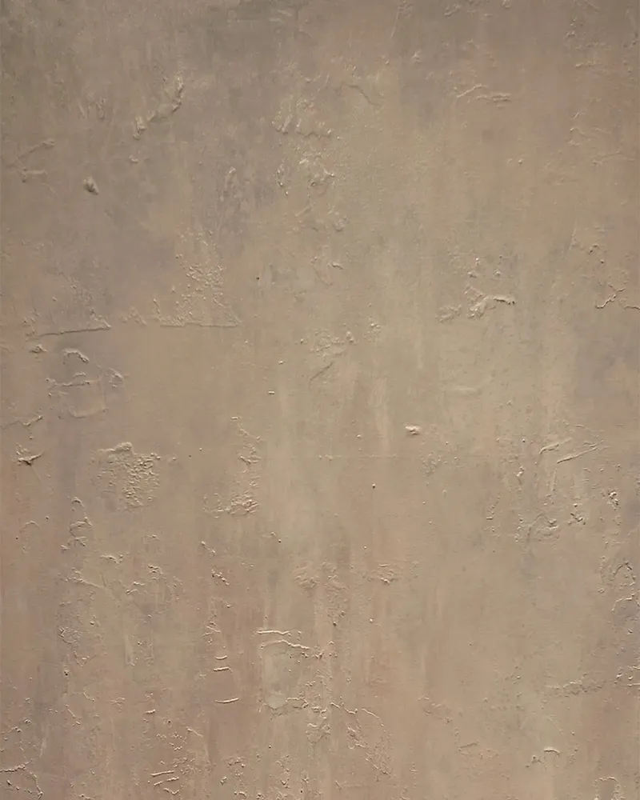
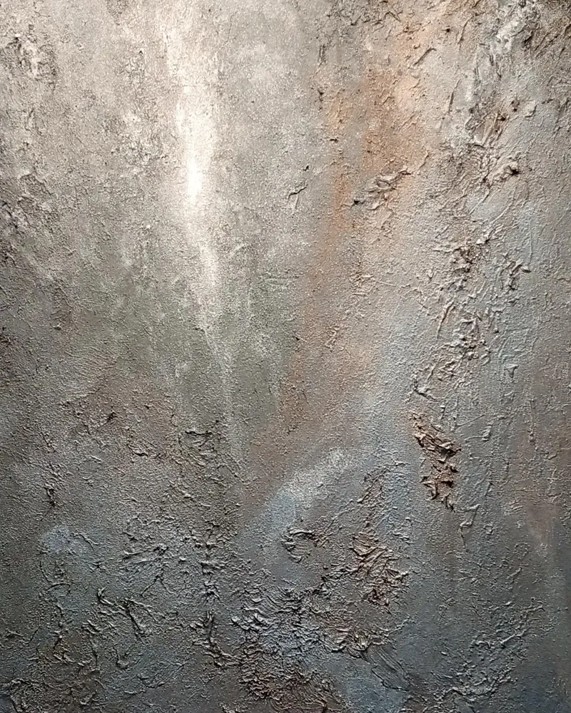

「裏裏（うらうら）」と「表表（ひょうひょう）」は、同じ時期に制作した対になる二つの作品です。どちらもアクリル・キャンバスで、「裏裏」は約120×75cm、「表表」は約90×60cm。黒に対する自分の考えと、それぞれの作品について振り返ります。

## 黒を下地に使っていたこと

これまで黒を下地に使っていました。色を重ねると黒になると考えていた一方で、黒にはどの色にもなりうるとも思っていました。

自分の心の内や過去、前世の闇（黒い部分）を隠したかったのかもしれない。黒を見ると、自分の内側を見ている気がして、目をそらしていたのかもしれない。

## 「表表」

「表表」は、これまで黒を見ないようにしていた表面的な自分だと感じています。

## 「裏裏」

「裏裏」は、自分と向き合った結果、黒を使って表現することを決めた作品です。そのなかで、黒に対する捉え方も変わったのだと思います。この道で進んでいくと決めた、僕にとっての決意表明のような作品だと考えています。

黒に向き合うことを考えるとき、この二つは一緒に紹介したい作品です。

抽象画で感情や記憶を色や形に置き換えてきたことは、[抽象画は、何を描いているの？](https://mizukioyama.github.io/blog/posts/abstract-painting-color-and-memory/)にも書きました。
